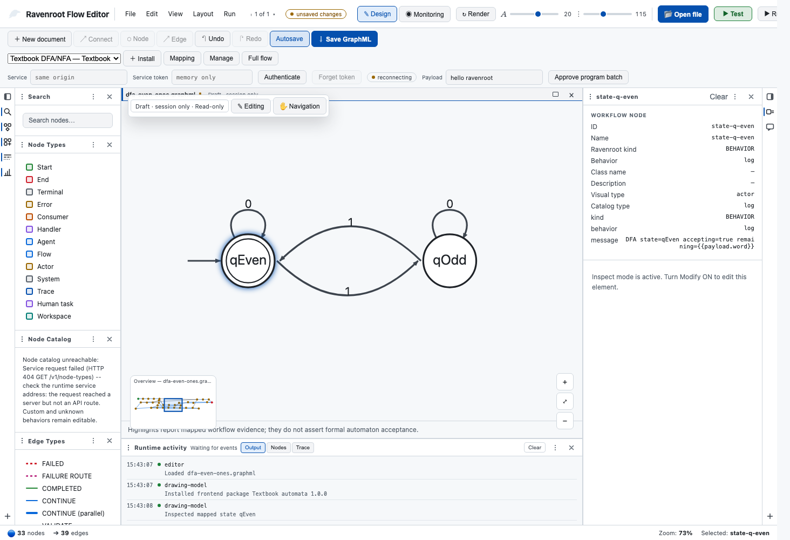

# Visualize a two-state DFA

In this exercise, learners inspect an executable even-ones workflow, map its operational paths to two
states, and render a textbook DFA projection. They then return to the full graph to explain what the
projection hides.

## Learning objectives

By the end, a learner can:

- explain the state invariant for even and odd counts of `1`;
- distinguish an executable GraphML path from a synthetic state-transition projection;
- identify the initial and accepting state and predict four transition results;
- connect a projected state or transition back to its real workflow evidence; and
- state why drawing-model highlights are not themselves an automaton acceptance result.

## Prerequisites

Use Ravenroot 0.7.0-alpha.1 source or a later version whose Workbench supports frontend drawing-model
packages. Package installation is verified for a Chromium-family browser. No server credential is
needed to inspect the sanitized example, but executing a complete workflow requires a connected,
configured runtime and the behavior contracts used by that workflow.

The repository contains all exercise files under
`ravenroot/ravenroot-ui/public/examples/frontend-plugins/textbook-automata/`:

- `ravenroot-frontend-plugin.json` and `plugin.js` form the installable presentation package;
- `dfa-even-ones-sanitized.graphml` preserves the workflow topology without claiming executable
  behavior for every internal step; and
- `dfa-even-ones-presentation.json` maps `qEven`, `qOdd`, and four transitions to real node and edge
  identifiers.

## Predict before opening Workbench

`qEven` is initial and accepting. Reading `0` preserves the current state. Reading `1` switches
between `qEven` and `qOdd`.

| Input | Expected final state | Accepted by this DFA |
|---|---|---|
| empty | `qEven` | yes |
| `0` | `qEven` | yes |
| `1` | `qOdd` | no |
| `1011` | `qOdd` | no |
| `1010` | `qEven` | yes |

## Install and map the drawing model

1. Open `dfa-even-ones-sanitized.graphml` in Workbench.
2. Open **Drawing options**, choose **Install package**, and select the `textbook-automata` directory.
3. Choose **Edit mapping**, paste the complete `dfa-even-ones-presentation.json`, and save it.
4. Select **Textbook DFA/NFA**.
5. Confirm the projection shows an incoming initial marker on `qEven`, a double accepting ring around
   `qEven`, a `0` loop on both states, and opposing `1` transitions.
6. Select each projected element. Confirm the Inspector identifies the mapped workflow node or the
   ordered edge path rather than an unrelated synthetic object.

*Figure 1. The drawing model reduces a larger operational graph to two states and four transitions.
The Workbench still selects evidence from the underlying workflow.*

## Compare the projection with the full flow

Choose **Full operational flow**. Trace the edge path mapped to `qEven` on input `1`. The full graph
contains parsing, empty-input checks, symbol validation, decisions, consumption, and routing that the
two-state projection deliberately hides.

Answer these questions:

1. Which real node is the evidence anchor for `qEven`?
2. Why is a transition represented by an ordered edge path instead of one visual edge?
3. What invalid-input behavior is visible in the full graph but absent from the textbook view?
4. If a mapped path is highlighted during monitoring, what further result would be required to claim
   that an input was accepted?

Expected answers: `state-q-even` is the `qEven` anchor; operational work spans several edges; symbol
validation and failure routing are deliberately omitted from the projection; and acceptance requires
the workflow's terminal result or other explicit execution evidence, not a drawing highlight.

## Further exercises

- Move the two state positions in the mapping, save GraphML, reopen it, and verify the presentation
  survives without changing workflow topology.
- Add a third synthetic state only after adding a real workflow evidence node and valid contiguous
  paths. Observe that mappings with missing or discontinuous evidence are refused.
- Compare the expanded flow with the interpreter evidence in
  [Finite-automata architecture evidence](../examples/finite-automata/). Explain why the interpreter,
  production contract, and drawing model are three different artifacts.
- Open `addition.graphml` from the [register-machine library](../examples/register-machine/) and
  identify its loop invariant and expected final registers.

## Recovery and limits

If package installation fails, verify browser support, manifest/API version, file sizes, UTF-8 source,
and declared integrity. If mapping validation fails, inspect missing node IDs, edge order, endpoints,
and provider capabilities. Removing or disabling the package leaves GraphML intact and restores the
integrated view.

The package runs in an opaque-origin frontend sandbox and returns a bounded declarative SVG scene.
It adds no network, storage, DOM, backend behavior, determinization, minimization, DOT import, or
automata execution authority.
