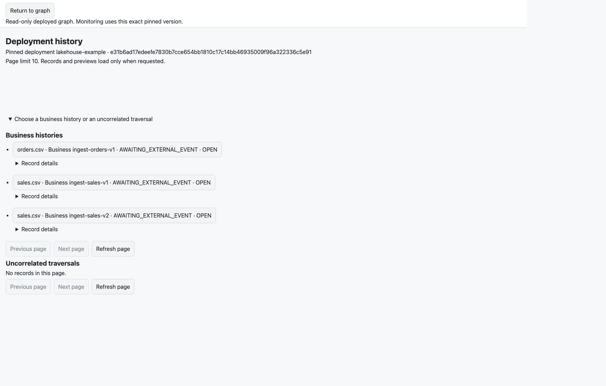
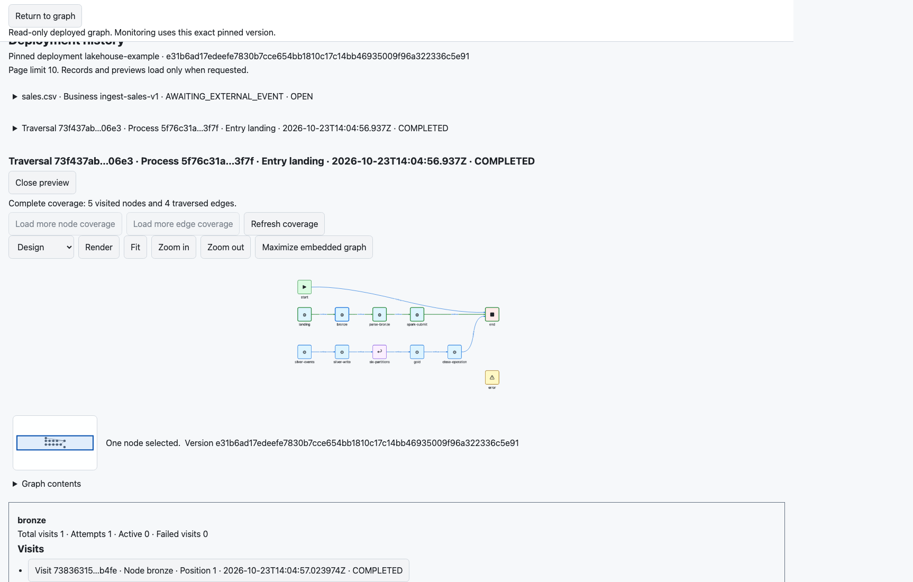
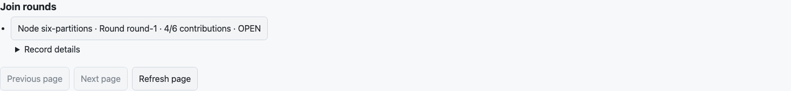
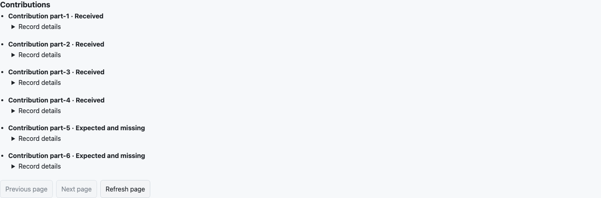
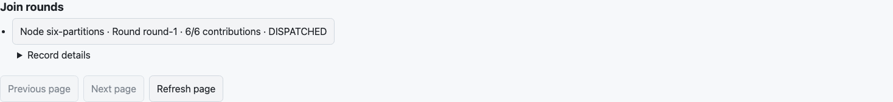
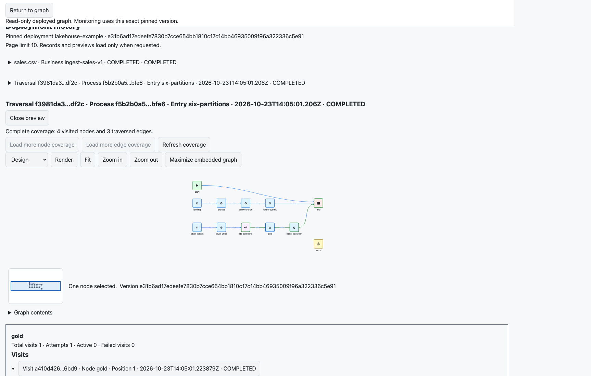

# Execute a file ingestion across six callbacks

This example executes Ravenroot's managed HTTP SOURCE, Pekko runtime, SQLite history, HTTP nodes,
correlated join and browser monitor. A separate bounded **HTTP fixture** writes local Bronze and
Silver files, accepts a simulated Spark job, and writes a Gold result. It does not run Apache Spark,
an object store, a lakehouse table format or a data catalog. Replace that cooperating service with
your application only after defining its authorization, idempotency and recovery contracts.

Open [lakehouse-six-partitions.graphml](lakehouse-six-partitions.graphml). Its original graph has
separate START, landing and Silver callback paths. Deploy opens the two listeners and runs no START
work. Every HTTP callback enters its owning SOURCE; it does not revisit START or another listener.
The graph uses actual supported behaviors, including the runtime's correlated PASSTHROUGH join.

## Reproduce the executed example

From a source checkout, use JDK 21–25, Maven, Node 24 and Chromium. Build the UI from its own directory:

```sh
cd ravenroot/ravenroot-ui
npm ci
npm run build
npx playwright install chromium
cd ..
mvn -pl ravenroot-extensions/ravenroot-openapi-server -am \
  -Dtest=LakehouseExampleBrowserTest -Dsurefire.failIfNoSpecifiedTests=false \
  -Dravenroot.deploymentPersistence.browserTest=true test
```

The public `LakehouseExampleBrowserTest` configures two distinct operator-owned OpenAPI profiles,
starts the shipped server/managed-ingress composition on loopback, executes the downloadable graph,
and runs the browser against that server. There are no replacement history responses or directly
seeded execution effects. Its `target/lakehouse-example/<run>/` directory contains the SQLite database,
actual `lake/<ingestionId>/` files, screenshots, browser measurements and execution observations.
The same opt-in runs in the full browser CI job. Without the browser property, the test still executes
the server, callbacks, runtime, store and external file effects, but produces no browser evidence.

For your own configured host, use [lakehouse-openapi.json](lakehouse-openapi.json) as the strict
OpenAPI 3.0.3 contract. Following the [OpenAPI operator configuration](../../reference/bundles/openapi-server.md#operator-configuration),
create these profiles under the package authority `/managed/openapi`:

| Profile | Relative route base | Allowed operation |
|---|---|---|
| `lakehouse-landing` | `/lakehouse-landing` | `landFile` |
| `lakehouse-silver` | `/lakehouse-silver` | `silverPartition` |

Both profiles use USER authority, the `idempotency-key` header and an 8,192-byte request ceiling.
The fixture authority requires `ravenroot.execute`; its projection permits only `content-type`,
`idempotency-key` and `x-business-operation`, with finite header/path/query limits. Keep the profile
route leases distinct. Give the HTTP behavior an operator-authorized external destination and finite
request/response/deadline limits, and replace `http://localhost:19090` in the graph with that exact
service. The fixture substitutes only its dynamically allocated endpoint. GraphML cannot grant
egress, credentials, ingress routes or public scopes. Configure authentication for your host; the
test uses the shipped explicitly local loopback composition.

## Admit concurrent files

[lakehouse-events.json](lakehouse-events.json) contains three synthetic inputs. Two refer to
`sales.csv`, with distinct ingestion IDs and versions. Submit each JSON object to
`/managed/openapi/lakehouse-landing/landing`, with `Content-Type: application/json`, a distinct
`Idempotency-Key`, and `X-Business-Operation` equal to its `ingestionId`.

The landing SOURCE explicitly selects `/body/ingestionId` and cross-checks
`/headers/x-business-operation`. It selects stage, round and public filename separately.
`ACCEPT_OR_CREATE` establishes the scoped business history. Filename is a human reference, not a
deduplication key. The Bronze HTTP node forwards the established context through dedicated headers;
its JSON result is explicitly parsed before the Spark submission node. These are separate real node
visits in the landing traversal.



*The actual browser distinguishes business ID from filename. A settled landing traversal leaves the
business history `AWAITING_EXTERNAL_EVENT`, rather than declaring the entire ingestion successful.*

Select `ingest-sales-v1`, then the actual traversal whose entry is `landing`. Its repeated preview
retains the complete deployed topology and highlights only that traversal's visited path. Select
`bronze` to inspect its visit, attempt, parent identity and terminal status. The other SOURCE and
Gold path remain present without being falsely painted as visited.



## Collect six explicit results

The simulated processor sends Silver callbacks to
`/managed/openapi/lakehouse-silver/silver`, retaining the original ingestion ID, filename, version and
round, setting `stage` to `silver` and `partition` to one of `part-1` through `part-6`. The header must
agree with the body ID. The SOURCE uses `REQUIRE_EXISTING`, so a callback cannot create an unrelated
history merely by presenting a filename. Each accepted callback is its own actual traversal, with
its original process, visit and attempt identities.

The executed sequence interleaves partitions 4, 2, 1 and 3 across all three ingestions. Five repeated
deliveries of the same first callback reuse its transport idempotency key and add no traversal.
The join's authored fixed manifest names all six distinct partition IDs; repeated IDs cannot fill
missing slots. The external Silver endpoint verifies the dedicated contribution header and writes
the corresponding real partition file before that arrival reaches the join.





*These are retained join facts with activity capture disabled. Completed arrival traversals do not
hide the two missing contributions, and Gold has not run.*

The fixture stops and starts the same deployment's listeners, then sends partitions 6 and 5 through
the real HTTP route. This proves source reconnect with retained state in the same host process; the
separate [custody and restart tests](../../reference/source-entry-contract.md#runtime-conformance)
cover process loss. Once all six distinct contributions commit, the durable READY outbox admits one
separate continuation at `six-partitions`. Gold runs once per business ID in this observed run.
Its successful result reaches the explicit audited close node. The history becomes `COMPLETED`
after admitted work settles; zero running arrivals alone was never the close condition.



Select the actual traversal whose entry is `six-partitions`, then `gold`. Its preview highlights
the continuation, rather than combining the earlier Bronze path and all arrivals into an invented
linear execution. Its actual visit and attempt remain independently inspectable.



## Observed bounds and recovery limits

The illustrated Chromium run made 20 history reads, returned at most 8 rows and 4,411 bytes per page,
and retained 832 monitor elements after the final inspection. Its maximum observed history response
time was 21.7 ms on that local run. These are measurements, not service-level guarantees. The monitor
uses operator page policy and explicit paging; it does not download arbitrary histories or payloads.
The larger [monitoring tests](../../user-guide/process-monitoring.md) cover thousands of histories
and visits separately.

The graph marks the POST effects `not-repeatable`. Successful execution here does not prove exactly
once external side effects across every crash window. An effect whose response is lost must use the
existing recovery/park authority and application reconciliation. A real Spark integration must
preserve the stable ingestion/partition/round identifiers in its own job and result protocol.
Transport request IDs and reply waiters remain separate from those business identifiers.
