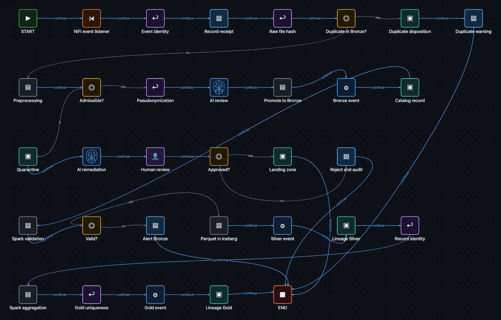
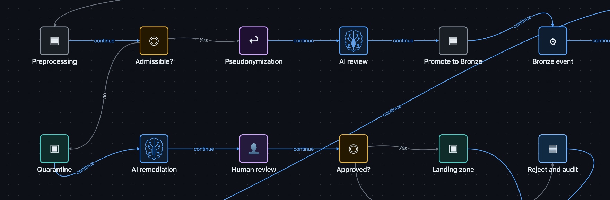

# Illustrated lakehouse ingestion scenario

This scenario uses a Ravenroot graph to explain how a file-ingestion process can make acquisition,
deduplication, quarantine, Bronze, Silver, Gold, lineage, and human review visible. It is an
**illustrative process model**. The downloadable GraphML deliberately contains `PASSTHROUGH`
placeholders and is not an executable NiFi, Spark, Iceberg, OpenMetadata, object-storage, AI, or
Human Task integration.

[Download the illustrative GraphML](lakehouse-ingestion-illustrative.graphml) and open it in
Workbench to inspect its structure. Do not run it as a production workflow.

*Figure 1. The complete visual model. Labels name business stages; they do not assert that the named
external systems or adapters are installed.*

## Learning goal and prerequisites

Use this walkthrough to separate process intent from runtime implementation. You need Workbench only
to inspect the GraphML. To make any stage executable, an integrator must replace its placeholder
with a supported behavior, configure an operator-owned profile and credentials where required, and
validate the resulting graph against the running catalog.

A realistic ingress contract would provide an immutable event ID, file identity, source URI,
content fingerprint, media type, size, acquisition time, and tenant. The example expressions assume
two booleans, `payload.fileDuplicate` and `payload.admissible`, plus a later
`payload.remediationApproved` decision. Those fields are illustrative application data, not Ravenroot
reserved fields.

## Follow one file

1. **Acquire and identify.** An external source admits a file event. The application assigns a stable
   event ID and computes a content fingerprint before downstream effects.
2. **Detect a duplicate.** The decision separates a previously accepted fingerprint from a new file.
   The duplicate path records an explicit disposition; it does not silently discard evidence.
3. **Preprocess and classify.** Parsing, media checks, malware controls, pseudonymization, and model
   inference belong to configured application components. Ravenroot coordinates their declared
   outcomes; it does not implement those data operations merely because the diagram names them.
4. **Quarantine and review.** An inadmissible or uncertain item enters quarantine. Automated
   remediation may prepare evidence, while a Human Task records an authorized response. Rejection
   remains observable and does not masquerade as infrastructure failure.
5. **Promote to Bronze.** After admission, application code writes the raw or normalized object and
   records catalog/lineage evidence. External acknowledgement and idempotency must be defined by the
   chosen adapter.
6. **Validate and transform to Silver.** Validation failures route to an explicit alert or remediation
   path. Successful transformation produces a new identified artifact rather than overwriting the
   source without provenance.
7. **Deduplicate and aggregate to Gold.** Record-level identity prevents repeated promotion. Gold
   aggregation and business rules remain application concerns whose receipts can be coordinated by
   the graph.

*Figure 2. Human review is one branch in the process model. The pictured AI and storage stages are
visual placeholders until replaced by supported configured behaviors.*

## Make a bounded slice executable

Do not implement the whole diagram at once. Select one slice with a measurable contract, for example
AMQP ingress to Human Task to AMQP publication:

1. Install and activate the required first-party bundles using the
   [plugin-bundle lifecycle](../../operator-guide/plugin-bundles.md).
2. Configure AMQP profiles, credential references, service grants, egress, and tenant authority.
3. Replace the ingress placeholder with the supported AMQP consumer behavior and map its payload to
   the application's file-event schema.
4. Replace the review placeholder with the documented Human Task behavior. Define responder
   authorization, presentation, timeout, and terminal outcomes.
5. Use a supported AMQP publisher for the accepted path. When the operation is part of a durable
   business transaction, adopt the [saga and outbox contract](../../operator-guide/saga-outbox.md)
   instead of treating broker acceptance as business completion.
6. Add an explicit failure route and verify connector error categories without embedding secrets.
7. Test with a disposable queue and synthetic file metadata, then record the execution ID, Human Task
   ID, selected outcome, publication receipt, and terminal result.

For the real integration contracts, follow [AMQP 0-9-1](../../reference/bundles/amqp091.md),
[Human Tasks](../../reference/human-tasks.md), [PostgreSQL persistence](../../reference/postgresql-persistence.md),
and [saga/outbox operations](../../operator-guide/saga-outbox.md). The PostgreSQL execution store and
outbox participate in different contracts; enabling one does not silently configure the other.

The repository's operational bundle and node references are canonical. This scenario links to those
contracts and does not duplicate their complete property tables.

## Expected observations

For the illustrative file, Workbench should show the complete structure and allow inspection of
every branch. It may report unknown `PASSTHROUGH` kinds; that is expected and is why the graph is not
executable.

For an implemented slice, expect the running catalog to expose every behavior, validation to accept
all required properties, ingress to create one correlated execution, the Human Task to remain pending
until an authorized response, and the accepted or rejected edge to record activity. External success
requires a domain receipt defined by the integration; a green node alone is not that receipt.

## Diagnose and recover

| Symptom | Diagnosis | Recovery and proof |
|---|---|---|
| Unknown `PASSTHROUGH` node | The downloaded graph is still illustrative | Replace only the intended slice with catalog-backed behaviors; validation names no unknown kind |
| Duplicate file is processed again | Fingerprint/idempotency contract is absent or scoped incorrectly | Repair the application-owned deduplication store and replay with a new test file; the original fingerprint keeps one accepted disposition |
| Human Task cannot be answered | Responder authority, tenant, revision, or presentation contract does not match | Use the Human Task runbook; the authorized response settles once with a new revision |
| Broker accepted but business state is unknown | Transport acknowledgement was mistaken for completion | Reconcile through the saga participant receipt or application inbox; terminal state records the known/unknown boundary |
| A promotion partially succeeded | External effect and lineage/catalog evidence were not atomic | Stop retrying blindly, reconcile the stable operation ID, and resume only through the configured recovery contract |

## Limits

This page does not claim a bundled lakehouse solution, ETL engine, data catalog, lineage store,
object-storage layout, model provider, or exactly-once external effect. It shows how Ravenroot can
make a verified application's orchestration and evidence explicit. Performance, capacity, retention,
and compliance depend on the selected adapters and operator configuration.
