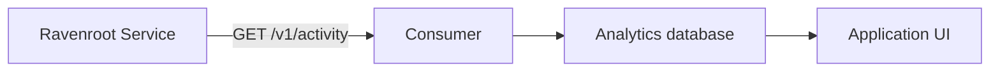

# Build an activity archive client

This guide builds a browser or backend client for node content retained by Ravenroot Service. It
covers incremental reads, retention gaps, an external analytics projection, and the boundary between
the HTTP contract and an embedded Java composition. Read the
[activity-capture operator guide](../operator-guide/activity-capture.md) first for the exact capture
policy, limits, redaction, storage, and failure semantics.

The activity archive is optional **Data** produced by Service execution. It is not a separate
Service, event stream, or database selected by the client. The operator enables capture and selects
the nodes and content kinds. The client reads only content that was captured, retained, and
authorized for its tenant.

## Prepare the Service

For a controlled environment, the smallest opt-in is:

```dotenv
RAVENROOT_ACTIVITY_CAPTURE_ENABLED=true
RAVENROOT_ACTIVITY_CAPTURE_POLICY=BEST_EFFORT
```

Restart the Service, run a graph containing a selected node, then make an authenticated request:

```bash
curl --get "$RAVENROOT_API_BASE/v1/activity" \
  --header "Authorization: Bearer $RAVENROOT_ACCESS_TOKEN" \
  --header 'Accept: application/json' \
  --data-urlencode 'after=0' \
  --data-urlencode 'limit=100'
```

`RAVENROOT_API_BASE` and `RAVENROOT_ACCESS_TOKEN` are client-side example variables. They are not
Service configuration. The identity needs `EXECUTION_READ`; its authenticated tenant fixes the
tenant scope. Do not send a tenant query parameter. For browser access, configure the exact allowed
origin and preserve the normal authentication flow described in
[identity and browser access](../operator-guide/identity-browser.md).

The endpoint accepts `after`, `limit`, `processInstanceId`, `traversalId`, `nodeId`, `invocationId`,
`attemptId`, and comma-separated `content` kinds. It rejects unknown parameters, invalid UUIDs,
negative or overflowing cursors, and page limits above the operator bound.

## Follow the cursor correctly

Treat `nextCursor` as an opaque position within one authenticated tenant, deployment source, and
filter set:

1. Start at `after=0`, or load the last committed checkpoint for the same source and filters.
2. Read one page and handle `gap` before its records.
3. Process records idempotently by `eventId`.
4. Save the server's `nextCursor` only after processing succeeds.
5. Repeat with `after=nextCursor`. An empty page is valid; wait before polling again.

Never calculate the next position from the record count, page limit, timestamp, or a cursor from the
execution-event API. Filtered cursor values can skip because unmatched records still occupy archive
positions. Concurrent writes can also make cursor order differ from timestamp order.

Retention produces an explicit successful response rather than silently hiding the discontinuity:

```json
{
  "gap": true,
  "nextCursor": 499,
  "retainedFromCursor": 500,
  "records": []
}
```

Record the discontinuity, rebuild the derived view from an authoritative snapshot when one exists,
and resume with the returned `nextCursor`. Repeating the expired cursor cannot recover deleted rows.
A gap reports history removed by retention; it does not prove whether a `BEST_EFFORT` capture was
lost before persistence.

## Add a TypeScript client

These are application types for the flattened HTTP response, not Java SDK types:

```typescript
export type ContentKind =
  | "INPUT_PAYLOAD" | "INPUT_ATTRIBUTES"
  | "OUTPUT_PAYLOAD" | "OUTPUT_ATTRIBUTES";

export type JsonValue =
  | null | boolean | number | string
  | JsonValue[] | { [key: string]: JsonValue };

export interface ActivityRecord {
  cursor: number;
  eventId: string;
  graphId: string;
  graphVersion: string;
  graphHash: string;
  processInstanceId: string;
  traversalId: string;
  nodeId: string;
  invocationId: string;
  attemptId: string;
  attemptOrdinal: number;
  contentKind: ContentKind;
  command: string;
  outcome: string | null;
  occurredAt: string;
  expiresAt: string;
  journalCausationId: string | null;
  causationActivityId: string | null;
  parentInvocationIds: string[];
  contentType: string;
  content: JsonValue;
}

export interface ActivityPage {
  gap: boolean;
  nextCursor: number;
  retainedFromCursor: number;
  records: ActivityRecord[];
}

export interface ActivityFilters {
  processInstanceId?: string;
  traversalId?: string;
  nodeId?: string;
  invocationId?: string;
  attemptId?: string;
  content?: ContentKind[];
}
```

Build the URL with an encoder, apply an independent client deadline, and preserve the previous cursor
when the request fails:

```typescript
export class ActivityHttpError extends Error {
  constructor(
    public readonly status: number,
    public readonly code?: string,
    public readonly correlationId?: string,
  ) {
    super(`Activity read failed: HTTP ${status}${code ? ` (${code})` : ""}`);
  }
}

export async function readActivity(
  apiBase: string,
  accessToken: string,
  after: number,
  filters: ActivityFilters = {},
  limit = 100,
  signal?: AbortSignal,
): Promise<ActivityPage> {
  if (!Number.isSafeInteger(after) || after < 0) {
    throw new Error("Cursor cannot be represented exactly by this client");
  }
  const base = apiBase.endsWith("/") ? apiBase : `${apiBase}/`;
  const url = new URL("v1/activity", base);
  url.searchParams.set("after", String(after));
  url.searchParams.set("limit", String(limit));
  for (const [key, value] of Object.entries(filters)) {
    if (value !== undefined) {
      url.searchParams.set(key, Array.isArray(value) ? value.join(",") : value);
    }
  }

  const timeout = new AbortController();
  const abort = () => timeout.abort();
  if (signal?.aborted) abort();
  signal?.addEventListener("abort", abort, { once: true });
  const timer = setTimeout(abort, 10_000);
  try {
    const response = await fetch(url, {
      headers: {
        Authorization: `Bearer ${accessToken}`,
        Accept: "application/json",
      },
      cache: "no-store",
      signal: timeout.signal,
    });
    if (!response.ok) {
      const error = await response.json().catch(() => undefined);
      throw new ActivityHttpError(response.status, error?.code, error?.correlationId);
    }
    const page = await response.json() as ActivityPage;
    if (typeof page.gap !== "boolean" || !Array.isArray(page.records)) {
      throw new Error("Invalid activity response");
    }
    const cursors = [page.nextCursor, page.retainedFromCursor,
      ...page.records.map(record => record.cursor)];
    if (cursors.some(cursor => !Number.isSafeInteger(cursor) || cursor < 0)
        || page.retainedFromCursor < 1 || page.nextCursor < after) {
      throw new Error("Invalid or inexact activity cursor");
    }
    return page;
  } finally {
    clearTimeout(timer);
    signal?.removeEventListener("abort", abort);
  }
}
```

Ravenroot cursors are signed 64-bit integers. A normal JavaScript JSON parse loses integer precision
above `Number.MAX_SAFE_INTEGER`; converting the rounded number to a string afterward cannot repair
it. A client that must cover the full range needs a lossless JSON parser and decimal-string or
`bigint` cursor handling from the first parse. Validate the remaining fields at runtime with the
validator used by your application.

## Load the next page in a view

Keep one request in flight for each view and discard its state when the authenticated context or
filter set changes:

```typescript
let cursor = 0;
let inFlight = false;
let requestGeneration = 0;
let activeRequest: AbortController | undefined;
const visible = new Map<string, ActivityRecord>();

function resetActivityContext(): void {
  requestGeneration += 1;
  activeRequest?.abort();
  activeRequest = undefined;
  inFlight = false;
  cursor = 0;
  visible.clear();
  renderRecords([]);
}

async function loadNextPage(): Promise<void> {
  if (inFlight) return;
  inFlight = true;
  const generation = ++requestGeneration;
  const request = new AbortController();
  activeRequest = request;
  try {
    const page = await readActivity(
      apiBase, await getAccessToken(), cursor, filters, 100, request.signal,
    );
    if (generation !== requestGeneration) return;
    if (page.gap) {
      showGap(page.retainedFromCursor);
    } else {
      for (const record of page.records) visible.set(record.eventId, record);
      while (visible.size > 500) visible.delete(visible.keys().next().value!);
      renderRecords([...visible.values()]);
    }
    cursor = page.nextCursor;
  } finally {
    if (generation === requestGeneration) {
      activeRequest = undefined;
      inFlight = false;
    }
  }
}
```

Call this from a user action or a bounded polling loop. A two-to-five-second poll interval is an
application choice, not a Service guarantee. A page can be empty immediately after execution because
capture completes asynchronously under `BEST_EFFORT`. Escape JSON for display, bound memory, and
show loading, empty, denied, failed, and retention-gap states separately. Missing output does not by
itself mean that the node failed. Call `resetActivityContext()` before replacing the authenticated
identity, Service origin, or filters. It aborts the old request and invalidates a late response so it
cannot populate the new view.

## Call the same API from Java

A backend does not need to embed Ravenroot. This JDK HTTP client uses the same tenant and authority
boundary as the browser endpoint:

```java
var client = HttpClient.newBuilder()
    .connectTimeout(Duration.ofSeconds(3))
    .build();

var endpoint = apiBase.resolve("v1/activity?after=0&limit=100");
var request = HttpRequest.newBuilder(endpoint)
    .timeout(Duration.ofSeconds(10))
    .header("Authorization", "Bearer " + accessToken)
    .header("Accept", "application/json")
    .GET()
    .build();

var response = client.send(request, HttpResponse.BodyHandlers.ofString());
if (response.statusCode() != 200) {
  throw new IllegalStateException("Activity API returned HTTP " + response.statusCode());
}
String json = response.body(); // Parse with bounded DTOs from the application.
```

Import `java.net.http.*` and `java.time.Duration`. Use an encoder for dynamic filters and a bounded
body handler for large pages. Keep bearer values out of logs and error messages. The HTTP record is
flattened JSON; it is not the same structure as SDK `ActivityArchiveRecord`, whose `event` contains
an `OpaquePayload`.

## Build an external analytics projection

Keep Service unchanged when the requirement is longer retention, content search, aggregation, or
classification. Run a consumer using the public API:



For each source and tenant:

1. Load its committed cursor, initially `0`, and read an unfiltered page.
2. On `gap:true`, record a discontinuity and reconcile the derived view before resuming.
3. Begin one analytics-database transaction.
4. Upsert records with a unique key such as `(source, tenant, event_id)`.
5. Save `nextCursor` in the same transaction, then commit.
6. On failure, retry from the previous committed cursor.

This ordering makes replay harmless and prevents a crash from committing a cursor before its rows.
Coordinate ownership when several jobs can import the same tenant. An unfiltered import preserves a
complete retained projection; a cursor advanced under one filter can skip rows later requested under
another filter.

A useful projection separates source identity, execution context, content, time, causality, and
derived analysis:

| Group | Suggested columns |
|---|---|
| Identity | source, authenticated tenant, `eventId`, source cursor |
| Context | graph/version/hash, process, traversal, node, invocation, attempt |
| Content | kind, JSON, media type, command, outcome |
| Time | source occurrence, source expiry, import time |
| Causality | parent invocations, selected input, journal reference |
| Derived | classifier output/version and search attributes |

The tenant comes from the import context; the REST record does not repeat it. Preserve source content
separately from derived fields and apply an explicit retention policy to the projection and backups.
A reliable importer still cannot reconstruct records that `BEST_EFFORT` never stored or retention
already removed.

## Choose REST, embedded Java, or direct database reads

| Need | Supported boundary |
|---|---|
| External UI or service | Authenticated `GET /v1/activity`; preferred public integration contract |
| Long-term analytics | REST consumer with transactional checkpoint and idempotent upsert |
| Application-composed runtime and custom redaction/archive | Embedded Java with `ActivityCapture`, `ActivityArchive`, and `AuthorizedRavenrootApplication` |
| Operational investigation of the Service database | Read-only SQL with explicit tenant enforcement and schema coupling |

Direct SQL bypasses REST authorization and its retention-gap contract. Never write Ravenroot's
activity tables: their cursors, identities, and watermark are archive-owned. Embedded Java also does
not automatically start the HTTP Service. Use `AuthorizedRavenrootApplication.activityAfter` for an
authenticated embedded boundary; the unwrapped application call requires its host to enforce tenant
identity itself. A custom `ActivityArchive` must provide tenant-filtered ordered reads, positive
tenant-local cursors, stable idempotency, conflict detection, retention maintenance, bounded
asynchrony, and durable acknowledgement rather than acknowledging a volatile queue.

## Verify the integration

Use a non-sensitive test payload and require these observations before enabling the feature for
production data:

1. Service startup accepts the capture configuration and the chosen persistent store is ready.
2. A graph run through one selected node creates the expected selected content kinds.
3. An authorized read returns the expected node, process, traversal, attempt, and JSON content.
4. A second read with `after=nextCursor` does not repeat an already traversed page.
5. A structured `token` test field appears as `[REDACTED]`.
6. An unauthorized identity is denied and another tenant cannot address this tenant's archive.
7. After Service restart, still-retained history remains readable from the configured volume or
   database.
8. A controlled retention test produces `gap:true`, records the discontinuity, and resumes from the
   server-provided cursor.

Keep the exact configuration, execution ID, client version, cursor sequence, and expected fields as
test evidence. Do not use production payloads or bearer values in fixtures. The canonical HTTP
schema and status mappings remain in [HTTP API and CLI](../reference/api-cli.md); this procedure does
not replace them.
