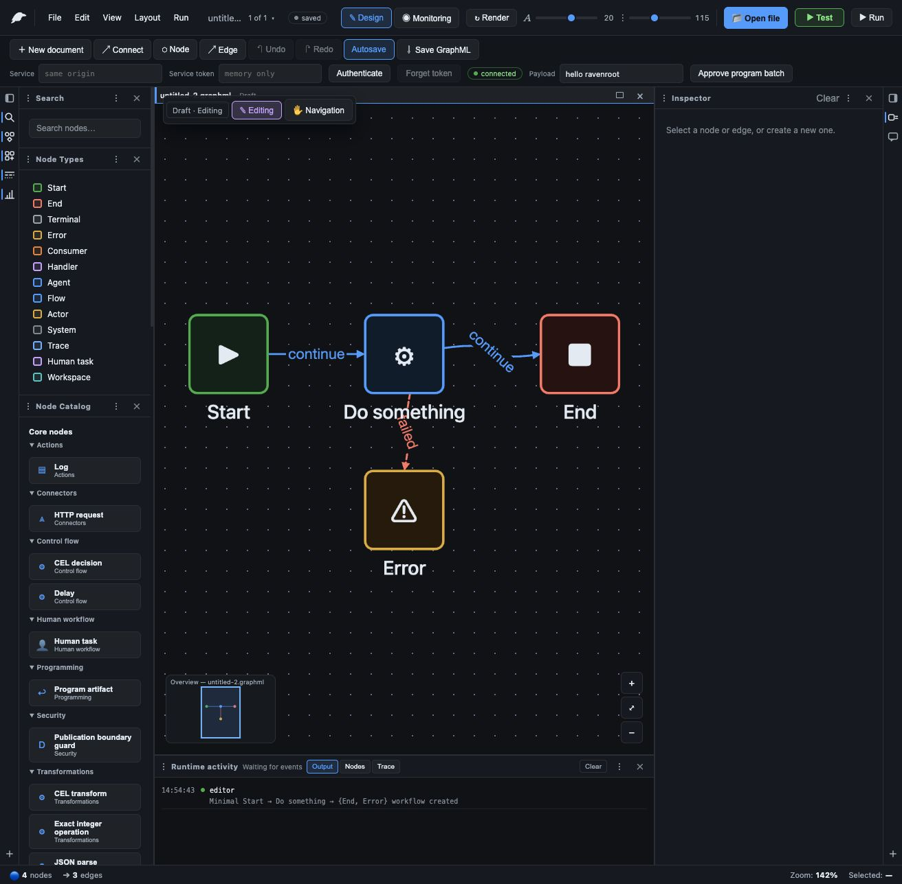
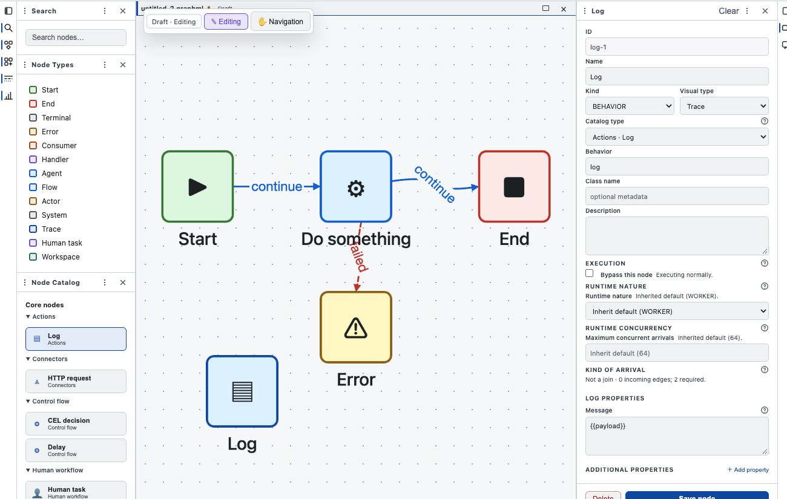
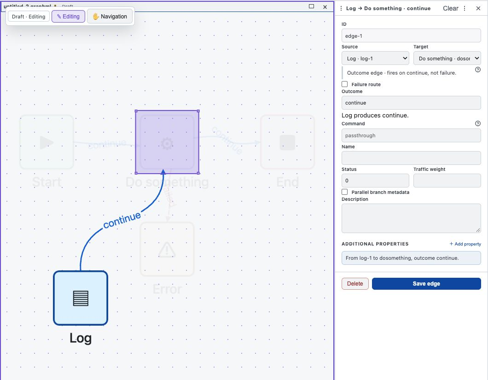
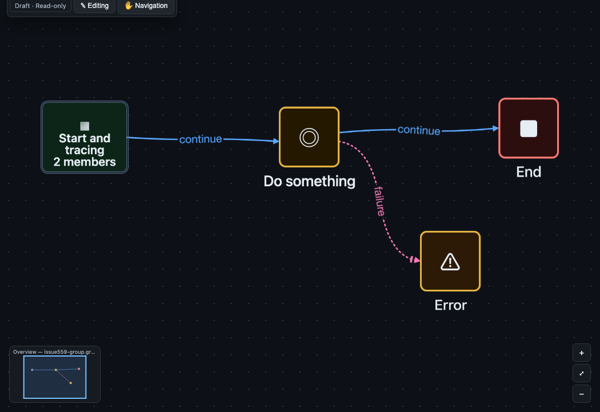

# Illustrated workspace guide

This guide takes a workflow author from an empty Ravenroot document to a saved GraphML workflow.
It focuses on the Workbench controls and on the evidence that proves each edit was accepted. For
the exact GraphML keys and runtime contracts, follow the linked reference pages instead of copying
values from a screenshot.

## Before you begin

Start a Ravenroot server or open an operator-provided Workbench URL. The service controls identity,
tenant, installed node bundles, credentials, and network authority. Workbench cannot grant those
capabilities to a graph. If the node catalog is unavailable, built-in shapes remain editable, but do
not assume an unknown behavior will run.

Have these items ready:

- a writable GraphML document or permission to create one;
- the intended service origin and an access token when the service requires authentication;
- a harmless payload for **Test** before a workflow performs external effects; and
- the operator profile or credential references required by any connector nodes.

*Figure 1. The Workbench separates graph structure in the center from the installed catalog on the
left, element properties in the Inspector on the right, and execution evidence below.*

## Understand the workspace

The **Node Types** palette chooses a visual role such as Start, End, Flow, Human task, or Workspace.
The **Node Catalog** chooses executable behavior exposed by the connected service. Visual type helps
people read the graph; behavior determines what Ravenroot executes. Keep them consistent, but do not
treat a shape as proof that a connector or runtime adapter is installed.

The document header reports whether the document is a draft, editable, session-only, or read-only.
The service bar reports connection and authentication state. **Design** edits the full operational
graph, **Monitoring** overlays activity evidence, and an installed drawing model may offer a synthetic
projection. A projection never replaces the GraphML workflow.

## Add and configure a node

1. Choose **New document**, or use **Open file** to load a GraphML document.
2. Turn on **Editing** for a writable document.
3. Drag a visual type to the canvas, then choose the intended catalog behavior. You can also drag a
   catalog entry directly when its default visual type is suitable.
4. Select the node. In the Inspector, set a stable ID and a concise name, then complete every field
   required by the selected behavior.
5. Review runtime nature, concurrency, arrival, and behavior properties. Leave inherited values in
   place unless the workflow contract requires an explicit override.
6. Save the node and confirm the canvas, Inspector, and document dirty state agree.

*Figure 2. The Inspector shows catalog identity and behavior-specific properties together. This Log
node renders the current payload; the exact template syntax remains a runtime contract.*

Unknown additional properties can be useful for forward-compatible GraphML, but they do not become
runtime authority. The active catalog and validator decide whether the document is admissible.

## Connect outcomes and failures

Choose **Edge**, then select the source and target. In the edge Inspector:

1. Use an outcome edge for a behavior-declared outcome such as `continue`, `yes`, or `no`.
2. Use a failure route only for operational failure. A negative business result is an ordinary
   outcome when the behavior declares one.
3. Confirm source, target, outcome, and failure-route status before saving.
4. Repeat for every declared branch that the procedure needs. A visible line without the correct
   outcome does not establish executable routing.

*Figure 3. Edge inspection makes routing explicit. Here `continue` is an ordinary outcome and the
failure-route option is clear.*

For parallel work, author the fan-out and the correlated arrival contract together. `each`, `all`,
and `any` have different completion behavior; use the [payload and routing guide](payload-routing.md)
and [GraphML reference](../reference/graphml.md) rather than inferring join semantics from geometry.

## Group without changing execution

Select at least two real nodes and create a visual group. Name it for the reader, then collapse or
expand it as needed. A visual group changes presentation only. It does not create a subgraph, a new
runtime scope, or a reusable component.

*Figure 4. A collapsed group reduces visual density while the underlying nodes and edges remain the
executable graph.*

## Test, run, observe, and save

Use **Test** first for a bounded evaluation with the payload shown in the service bar. Test behavior
depends on the selected nodes and their effect policies; it is not a blanket dry run for every
connector. Correct validation errors, missing catalog entries, credential/profile failures, and
blocked egress before attempting **Run**.

Use **Run** only when the graph and its operator-controlled dependencies are ready. Record the
execution ID printed by the service, then inspect output, node activity, and trace evidence. The
runtime activity panel is evidence for the selected execution; it is not a durable process inventory.
For deployment and process scope, continue with [Observe deployments and processes](process-monitoring.md).

Choose **Save GraphML** and reopen the file. Verify that node IDs, behavior properties, edge outcomes,
visual groups, and any drawing-model selection survived the round trip. A successful browser save
does not publish, deploy, or activate the graph.

## Diagnose common failures

| Observation | Likely boundary | Action | Verification |
|---|---|---|---|
| Catalog unavailable | Service origin, authentication, or API route | Check the service URL and authenticate; use the startup runbook when the API is not ready | The catalog loads from the intended service and lists expected behaviors |
| Behavior missing | Optional bundle absent or inactive | Follow the plugin-bundle procedure; do not substitute an unknown behavior | The running catalog exposes the exact behavior ID |
| Test refuses a connector | Profile, credential, grant, egress, or effect policy | Resolve the named operator contract | Test reports an admitted result without widening authority |
| Edge never receives work | Outcome name or arrival contract does not match | Compare the edge with the descriptor and routing reference | Validation passes and the expected edge records activity |
| Saved file loses a projection | Drawing package or mapping identity is unavailable | Install the compatible package and validate the persisted mapping | Reopen the GraphML and select the recorded drawing model |

Use [Graph validation and execution](../troubleshooting/graph-execution.md) for runtime failures and
[AI, artifacts, plugins, and connectors](../troubleshooting/ai-extensions.md) for optional packages.
