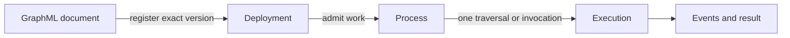

# Observe deployments and processes

This guide explains how to move from a graph document to the correct operational scope. It helps an
author or operator distinguish an open document, a registered deployment, a durable process, and one
execution before issuing a lifecycle command.



The scopes are related but not interchangeable. Opening a document does not select a deployment.
Selecting a deployment does not start work. Choosing an execution in the Workbench does not change
the whole deployment.

## Select the evidence scope

1. Confirm the service origin, tenant, and authenticated subject.
2. Open **Run > Deployments** and refresh the inventory.
3. Match the intended deployment by durable ID, graph version, and observed state. Display names are
   useful labels, not durable identity.
4. Choose **Open read-only view** to inspect the registered graph without changing the authoring
   document.
5. Choose the deployment for process inspection, then select a process and execution explicitly.
6. Record the current revision before sending a lifecycle intent. A later retry of the same intent
   keeps its idempotency key; a new intent gets a new key.

The global lifecycle console can expose Start, Pause, Resume, Cancel admitted work, Drain, Stop,
Restart, and Undeploy. Availability depends on current state, authority, and the service's durable
lifecycle capabilities. A disabled command is evidence that a precondition is not satisfied.

## Read Monitoring mode

Monitoring overlays activity on the graph selected in the current document or deployment view.
Confirm the selected deployment and execution before interpreting highlights. A highlighted node or
edge means matching evidence exists for that scope; it does not by itself prove business completion,
durable settlement, or acceptance by an external system.

When several paths are active, use the process inventory and execution IDs to separate concurrent
work. Node counts describe activity at a point in time. Use the retained result and event stream for
terminal facts, and follow the persistence guide for retention boundaries.

## Choose the lifecycle action

| Intent | Scope and effect | Verify afterward |
|---|---|---|
| Pause | Holds admissible progress where the configured engine and stores support it | Process state, revision, and absence of newly admitted steps |
| Resume | Releases a paused process or deployment according to its durable lifecycle contract | New revision and renewed activity |
| Cancel | Settles the selected process or traversal through cancellation semantics | Terminal result and cancellation evidence, not a generic failure |
| Drain | Stops admitting new work and waits for admitted work according to policy | Admission state and remaining in-flight work |
| Stop | Stops a deployment while retaining registration | Deployment state and retained identity |
| Undeploy | Removes the deployment registration after its disposition rules are satisfied | Deployment absent from refreshed inventory |

Do not automate a rollout by chaining UI labels. Use the documented API/CLI contract and verify each
state transition before the next action. The [global lifecycle console](../operator-guide/lifecycle-console.md),
[persistence and recovery guide](../operator-guide/persistence-lifecycle.md), and
[HTTP API and CLI reference](../reference/api-cli.md) are the canonical command contracts.

## Follow the same scopes with the CLI

Point the application CLI at the same Service shown in the Workbench. Keep the bearer in a protected
file instead of a command-line argument:

```bash
rr() {
  ravenroot --server https://ravenroot.example \
    --token-file /secure/path/ravenroot.token "$@"
}

rr status
rr node-types
rr inventory
rr deployments list
rr human-tasks list
```

The URL and token path are placeholders. The token's tenant and authorities remain effective; the
CLI does not elevate them. `inventory` follows the durable tenant inventory, including terminal
rows, when the configured store supports it. `live` is narrower: it lists non-terminal executions
known to the current Service process.

Use a local validation before registering a graph, then inspect each remote transition:

```bash
rr validate /path/to/orders.graphml
rr deployments register orders-v1 /path/to/orders.graphml
rr deployments inspect orders-v1
rr deployments start orders-v1
rr deployments inspect orders-v1
```

`validate` remains local even when `--server` is present. Registration validates and reserves the
deployment ID; it does not start the deployment. For a controlled retirement:

```bash
rr deployments stop orders-v1 --reason 'Scheduled maintenance'
rr deployments inspect orders-v1
rr deployments undeploy orders-v1 \
  --disposition REFUSE_IF_BUSY --reason 'Version retired'
rr deployments list
```

Durable Stop requires a reason. Durable Undeploy also requires an explicit disposition and leaves a
tombstone, so its ID cannot be reused. A stale generation, refusal, or idempotency conflict is a
decision to inspect; do not hide it by generating a new intent automatically.

Process control uses a different identity and revision scope:

```bash
# Read PROCESS_INSTANCE_ID and REVISION from the current inventory first.
rr process PROCESS_INSTANCE_ID pause REVISION pause-20261016-001
rr inventory
rr process PROCESS_INSTANCE_ID resume UPDATED_REVISION resume-20261016-001
rr result EXECUTION_ID
```

Each new intent gets a new idempotency key; an exact retry keeps the original key. `traversals` takes
a process-instance ID, while `result` and `cancel` take an execution/traversal ID. `rr drain` drains
Service admission, `rr process ... drain` controls one durable process, and `deployments stop`
controls a deployment registration. These scopes must not be substituted for one another.

The CLI has no `events tail` command. `ravenroot events decode` only decodes an SSE capture received
on standard input. Follow live events with an authenticated `GET /v1/events`, or read retained events
from `GET /v1/events/recent`; never put a bearer in the query string. See
[command-line tools](../reference/command-line-tools.md) for complete arguments and exit behavior.

## Failure diagnosis

- **The intended deployment is absent:** refresh the correct tenant and service, then verify whether
  registration succeeded. Do not register a duplicate under a guessed ID.
- **A command is disabled:** inspect the displayed reason, state, revision, and authority. Do not
  widen permissions or skip a lifecycle precondition.
- **A retry conflicts:** reread the current revision. Reuse the idempotency key only for the same
  intent; formulate a new intent against the new revision when the desired action changed.
- **The graph looks idle while work exists:** confirm the selected execution and event retention.
  Monitoring highlights are a projection of evidence, not the durable inventory itself.
- **Undeploy remains pending:** inspect admitted work and disposition rules. Drain, cancellation, and
  undeploy are separate contracts.

## Continue into the operating contracts

The screenshots and command map above are the observation path. Use the corresponding contract
before changing a running environment:

| Question | Canonical guide |
|---|---|
| How do Service configuration, Data capture, credentials, profiles and caller authority differ? | [Configuration](../reference/configuration.md), [credentials and egress](../operator-guide/credentials-egress.md), [identity and browser access](../operator-guide/identity-browser.md), and [persistence lifecycle](../operator-guide/persistence-lifecycle.md) |
| How do CLI calls preserve tenant and revision scope? | [HTTP API and CLI](../reference/api-cli.md) and [command-line tools](../reference/command-line-tools.md) |
| How do register, start, stop and undeploy expose rollout evidence? | [Deployment and startup](../operator-guide/deployment-startup.md) and [graph source control](../operator-guide/graph-source-control.md) |
| Which topology owns execution and recovery? | [Kubernetes installation](../operator-guide/kubernetes-installation.md), [governed runners](../operator-guide/governed-runners.md), [Kubernetes runners](../operator-guide/kubernetes-runners.md), and [PostgreSQL persistence](../reference/postgresql-persistence.md) |
| How do people and external systems resume durable work? | [Human Tasks](../reference/human-tasks.md), [Human Task operations](../operator-guide/human-tasks.md), and [saga/outbox](../operator-guide/saga-outbox.md) |

These guides describe separate authority, persistence, and failure boundaries. A successful visual
action does not imply that a different tenant, deployment, runner, or recovery topology is ready.
